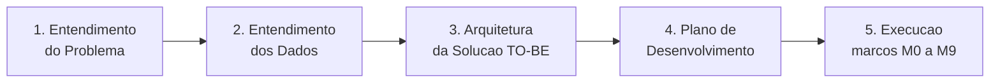

# Verificação Automatizada de Fotos de Leitura

> Ponto de entrada do vault. Base de conhecimento do Projeto 4 (DADOS) para a Neoenergia Pernambuco, organizada segundo o CRISP-DM. Comece por aqui.

---

## 1. O Problema em Uma Frase

A Neoenergia Pernambuco recebe de **30 a 50 mil fotos de medidores por dia** que precisam ser conferidas, e tem **6 pessoas** para fazer isso manualmente, com **1 dia de atraso**. O projeto automatiza essa triagem com visão computacional.

---

## 2. Mapa das Fases

| Fase | Nota | Para quem |
| --- | --- | --- |
| 1. Entendimento do Problema | [[01_Entendimento_do_Problema]] | Cliente e time |
| 2. Entendimento dos Dados | [[02_Entendimento_dos_Dados]] | Cliente e time |
| 3. Arquitetura da Solução (TO-BE) | [[03_Arquitetura_Solucao_TOBE]] | Cliente e time |
| 4. Plano de Desenvolvimento | [[00_Visao_Geral]] | Time apenas (operacional) |

---

## 3. Plano de Desenvolvimento (execução técnica)

Documentos internos do time. Não são material de cliente.

| Nota | Conteúdo |
| --- | --- |
| [[00_Visao_Geral]] | Restrições local-first, dados reais, arquitetura, faseamento |
| [[01_Ambiente_e_Repositorio]] | Toolchain, versões, estrutura de pastas, Makefile, compose |
| [[02_Dados_Contratos_Ingestao]] | Parsing do CSV, esquema do banco, validações, quarentena |
| [[03_Backend_API_Workers]] | FastAPI, fila no Postgres, autenticação, endpoints |
| [[04_Visao_Computacional]] | Heurísticas, treino, métricas, ONNX, calibração de limiar |
| [[05_Frontend_e_Rotulagem]] | React, telas, rotulagem dupla-cega |
| [[06_Milestones_e_Aceite]] | Marcos M0 a M9 com critérios de aceite verificáveis |

---

## 4. Números que Ancoram o Projeto

Medidos diretamente nos 4 lotes de `Base cliente/`, não estimados. Detalhes em [[02_Dados_Contratos_Ingestao]].

| Métrica | Valor |
| --- | --- |
| Linhas de CSV | 13.669 |
| Imagens | 12.340 |
| Leituras sem nota | 9.109 (66,6%) |
| Leituras com nota | 4.560 (33,4%) |
| Nota exige foto mas não tem | 296 |
| Nota não exige mas tem foto | 562 |
| Fotos órfãs (em disco, sem CSV) | 866 |
| Linhas com múltiplos medidores | 1.316 (até 8 por linha) |
| Código não mapeado | `V100`, 6 ocorrências |
| Resolução das imagens | 360×480, sem EXIF |

Estes números são o **teste de regressão** da ingestão. Ver [[06_Milestones_e_Aceite]], marcos M1 e M2.

---

## 5. Achados que Mudaram o Rumo

O que a análise dos dados reais revelou e que não estava nos documentos iniciais.

### 5.1 O código I100 não existe nos dados

`I100` (Local de Consumo Fechado) é o exemplo canônico usado em [[01_Entendimento_do_Problema]] e [[03_Arquitetura_Solucao_TOBE]], mas tem **zero ocorrências** na base. **42 dos 61 códigos nunca aparecem.** Os 8 códigos com volume real (96% das notas) esperam todos a mesma cena: o display do medidor.

Consequência: o classificador de coerência foto contra ocorrência **não é treinável** com os dados atuais. Detalhado em [[00_Visao_Geral]], seção 3.1.

### 5.2 Não dá para provar erro de 0,5% com 300 rótulos

Pela regra dos três, zero erro em 150 amostras só sustenta "erro abaixo de 2%". Para o alvo de 0,5% são necessárias cerca de 600 amostras auto-aprovadas rotuladas. Por isso a auto-aprovação nasce **desligada**. Detalhado em [[04_Visao_Computacional]], seção 5.1.

### 5.3 Triagem em tempo real na captura não é viável na v1

O app de campo é de terceiros e caixa-preta. A triagem acontece na ingestão (minutos após o lote chegar), não no momento da foto. Ver [[03_Arquitetura_Solucao_TOBE]], seção 2.

---

## 6. Pendências com o Cliente

Bloqueiam trabalho e precisam de resposta. Fonte: [[00_Visao_Geral]], seção 7.

- [ ] Amostra dirigida com cenários físicos (`I100`, `I140`, `I160`, `D1xx`, `E101`, `G100`), mínimo 100 fotos por código
- [ ] Explicação das 866 fotos órfãs
- [ ] Significado do código `V100`
- [ ] Semântica dos múltiplos medidores separados por `/`
- [ ] Viabilidade de fornecer imagens acima de 360×480
- [ ] Existência de API ou webhook no app de terceiros
- [ ] SLA formal entre captura e aprovação

---

## 7. Estado da Execução

| Marco | Escopo | Estado |
| --- | --- | --- |
| M0 | Ambiente e esqueleto | **Concluído** |
| M1 | Ingestão e domínio | A fazer |
| M2 | Validação e quarentena | A fazer |
| M3 | API, autenticação e fila | A fazer |
| M4 | Frontend de revisão | A fazer |
| M5 | Heurísticas de qualidade | A fazer |
| M6 | Rotulagem e ground truth | A fazer |
| M7 | Modelo de qualidade | A fazer |
| M8 | Operação e métricas | A fazer |
| M9 | Spike de OCR (paralelo) | A fazer |

Critérios de aceite de cada marco em [[06_Milestones_e_Aceite]].

---

## 8. Como Navegar Este Vault

- **Grafo** (ícone de grafo na barra lateral): mostra como as notas se conectam. Notas do plano de desenvolvimento aparecem em cor distinta.
- **Backlinks** (painel direito): mostra quem cita a nota aberta. Útil para ver o impacto de mudar uma decisão.
- **Busca por tag**: `tag:#crisp-dm` traz as notas de fase, `tag:#desenvolvimento` traz as de execução.
- **Diagramas**: as notas usam Mermaid, que o Obsidian renderiza nativamente no modo de leitura.

O vault vive em `CRIPS-DM/` dentro do repositório de código, então documentação e implementação versionam juntas.
