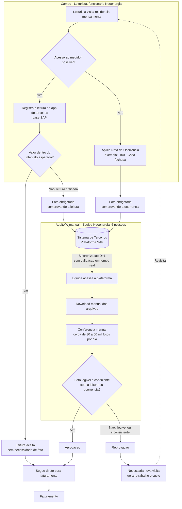

# Entendimento do Problema — Verificação de Fotos de Leitura

> Documento de uso interno do time. Consolida o entendimento do problema da Neoenergia Pernambuco a partir do desafio formal, das entrevistas realizadas e do refinamento feito com o time. Serve de base para o Kickoff (12/09) e para as próximas fases do CRISP-DM.

---

## 1. Contexto do Negócio

A Neoenergia Pernambuco (ex-CELPE, privatizada em 2000, integrada ao grupo Neoenergia/Iberdrola, com o nome atual adotado em 2021) é a distribuidora responsável por praticamente todo o estado de PE. A área de **leitura e entrega de contas** visita praticamente todos os clientes mensalmente para garantir que a medição seja feita corretamente e que a fatura chegue até eles — atividade estratégica para o caixa da empresa, já que assegura o registro e a cobrança da receita.

## 2. Problema Central

A **fiscalização das fotos tiradas pelos leituristas em campo** — usadas para comprovar leituras suspeitas ou justificar ocorrências — não acompanha o volume da operação. O processo de auditoria é manual, reativo e por amostragem, gerando:

- Baixo controle de qualidade (nem sempre é possível confirmar se a foto corresponde ao medidor do cliente);
- Alto custo de tempo (revisão manual de milhares de fotos/dia);
- Risco de inconsistências que chegam até a fatura do cliente, afetando confiança e receita.

## 3. Processo Atual (AS-IS)

### 3.1 Visão Geral

O leiturista (funcionário da Neoenergia) visita todas as residências mensalmente e registra a leitura em um **aplicativo de terceiros, baseado em SAP**, que também é responsável por capturar e armazenar as fotos. Uma foto só é exigida quando o processo identifica necessidade de comprovação — por leitura suspeita ou por ocorrência aplicada. Essa foto fica armazenada na plataforma do terceiro, e é **acessada apenas no dia seguinte (D+1)** por uma equipe interna de 6 avaliadores, que baixa os arquivos manualmente e faz a conferência.

### 3.2 Diagrama de Fluxo (AS-IS)

### 3.3 Atores e Sistemas Envolvidos

| Ator / Sistema | Responsabilidade | Propriedade |
|---|---|---|
| Leiturista | Captura da leitura e, quando exigido, da foto de evidência | Funcionário Neoenergia |
| App de leitura/foto (base SAP) | Registro da leitura, captura e armazenamento da foto | Terceiro (fora do controle direto da Neoenergia) |
| Equipe de auditoria (6 pessoas) | Download manual e conferência das fotos críticas | Neoenergia |
| Sistema de faturamento | Consome a leitura validada (ou aceita automaticamente) | Neoenergia |

### 3.4 Gatilhos que Exigem Foto

1. **Leitura suspeita**: o valor lido ultrapassa um intervalo esperado → leitura é "criticada" → foto do medidor é obrigatória.
2. **Nota de ocorrência**: quando o leiturista não consegue acessar o medidor (casa fechada, medidor interno sem acesso, etc.) → aplica um código de ocorrência (ex.: *I100 – Casa fechada*) → foto de evidência é obrigatória (ex.: fachada/portão fechado).

## 4. Volumetria e Escala

| Métrica | Valor | Observação |
|---|---|---|
| Fotos críticas por dia | ~30.000 a 50.000 | Fotos que exigem conferência manual (leitura suspeita + ocorrências) |
| Equipe de auditoria | 6 pessoas | Faz o download e a conferência manual |
| Defasagem da auditoria | D+1 | Foto só é verificada no dia seguinte à captura |
| Nº de leituristas em campo | *A confirmar* | Não relevante para o problema neste momento |

## 5. Gargalos e Falhas Identificadas

| # | Gargalo | Onde ocorre no processo | Causa raiz | Impacto |
|---|---|---|---|---|
| 1 | **Escala humana inviável** | Auditoria manual | 30-50 mil fotos/dia para 6 pessoas revisarem | Baixa cobertura real, fiscalização por amostragem, risco de erro passar despercebido |
| 2 | **Defasagem estrutural (D+1)** | Sincronização → Auditoria | Foto só é acessada e verificada no dia seguinte à captura | Perda de tempo útil, impossibilidade de correção imediata em campo |
| 3 | **Falta de triagem na origem** | Captura em campo | Fotos ilegíveis são enviadas e só são identificadas como inválidas na auditoria manual, um dia depois | Trabalho manual desperdiçado revisando fotos que já nasceram inválidas; a rejeição deveria acontecer no momento da captura |
| 4 | **Dependência de terceiros** | Captura e armazenamento (app/plataforma SAP) | O app de campo e o sistema de armazenamento são de terceiros, fora do controle direto da Neoenergia | Limita onde a solução de IA pode atuar diretamente na fonte (Ponto A da arquitetura) — provável necessidade de integração/API ou atuação no ponto de auditoria, não na captura |
| 5 | **Inconsistências de acesso ao medidor** | Campo (nota de ocorrência) | Casas fechadas, medidores internos sem acesso, etc. | Fotos que não comprovam a leitura em si, mas precisam ser validadas quanto à coerência com a ocorrência aplicada |
| 6 | **Retrabalho e revisita** | Pós-auditoria (reprovação) | Foto reprovada (ilegível/inconsistente) exige nova visita presencial | Custo operacional adicional, atraso no ciclo de faturamento, insatisfação do cliente |

> **Observação sobre o Gargalo 3**: essa é a falha mais crítica do ponto de vista de eficiência — o ideal seria rejeitar a foto ilegível *no momento da captura*, antes mesmo do envio. No entanto, como o app de campo é gerenciado por terceiros (Gargalo 4), essa intervenção na fonte é mais complexa de implementar e depende do nível de acesso/integração que a Neoenergia tem com essa plataforma. Isso é um ponto crítico a validar antes de desenhar a solução técnica.

## 6. Impactos do Problema

**Estratégicos**
- Risco à confiança do cliente e à credibilidade de mercado da Neoenergia;
- Risco de perda de receita por erros de fatura;
- Vai contra a meta de ser reconhecida como distribuidora moderna, transparente e eficiente.

**Operacionais**
- Aumento de retrabalho (revisitas);
- Custos extras de operação;
- Redução da produtividade da equipe de leitura e da equipe de auditoria.

## 7. Direção Preliminar da Solução

O desafio já aponta a direção: automação com IA/Visão Computacional, validando não apenas se a foto corresponde ao medidor e à leitura, mas também se ela é **coerente com a nota de ocorrência aplicada** (ex.: I100 deve mostrar claramente portão/fachada fechada). O detalhamento da arquitetura futura (pontos de inserção da IA, modelos, fluxo de triagem automática vs. exceção humana) será tratado em documento específico de solução (TO-BE), nesta fase o foco é o entendimento e delimitação do problema.

## 8. Perguntas em Aberto / Lacunas para Validação

- [ ] O app/plataforma de terceiros (base SAP) oferece algum tipo de API ou webhook que permita validação em tempo real, ou o acesso é só via download manual?
- [ ] Quais são, além de I100, as principais notas de ocorrência usadas e seus respectivos padrões esperados de foto?
- [ ] Existe algum SLA formal para o tempo entre captura da foto e aprovação/reprovação?
- [ ] O contrato com o terceiro permite algum tipo de integração ou é uma "caixa-preta" só de consulta?

## 9. Fontes de Dados Mapeadas (para pesquisa)

- Roteiro de entrevista estruturado (7 blocos temáticos) — já parcialmente aplicado com profissional da Neoenergia;
- Logs/exportações do app de terceiros (a confirmar acesso);
- Base fornecida pelo cliente.

## Referências

- Documento de Desafio — Projeto 4 DADOS (Neoenergia Pernambuco)
- Apresentação da Disciplina — Projeto 4 (CESAR School, Prof. Erick Simões)
- Entrevista preliminar com profissional da Neoenergia (roteiro estruturado)
- Índice do vault: [[00_Indice]]
