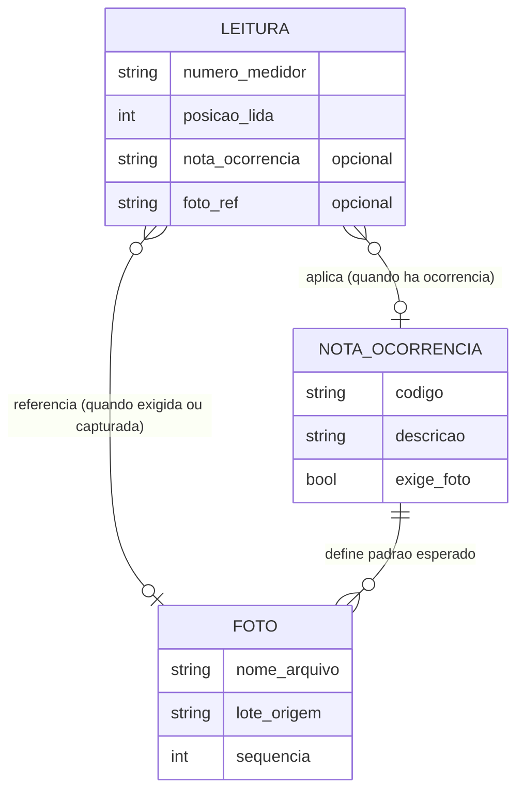
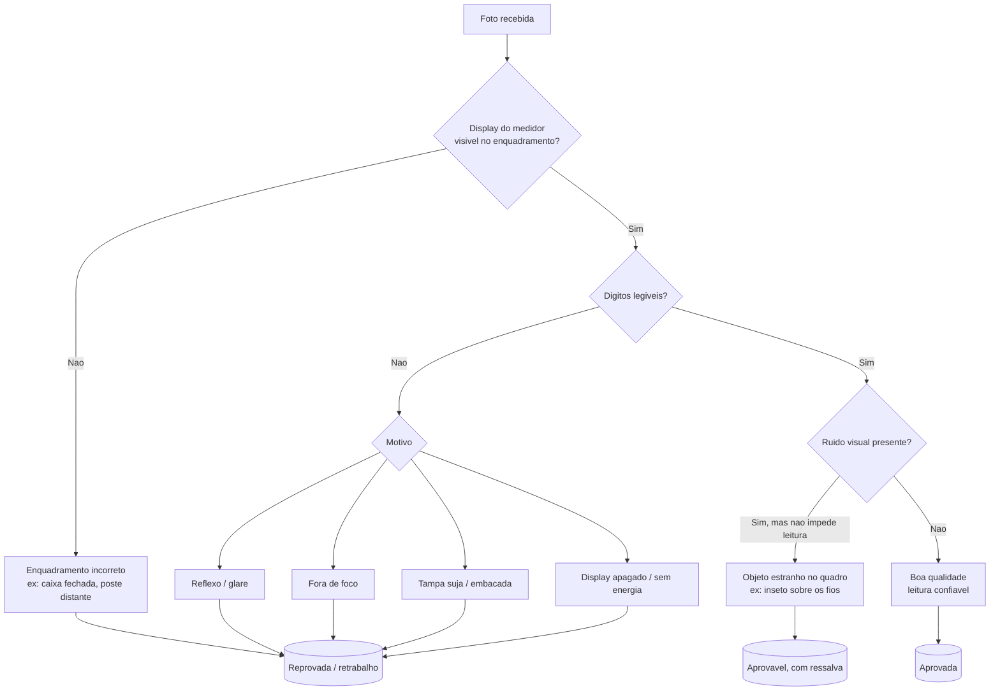

# Entendimento dos Dados — Verificação de Fotos de Leitura

> Documento de uso interno do time. Consolida o entendimento dos dados fornecidos pela Neoenergia Pernambuco referentes a todo o dataset do projeto (~9.000 fotos distribuídas em 4 pastas, com seus respectivos CSVs de extração), e do refinamento feito com o time. Complementa o `01_Entendimento_do_Problema.md` e serve de base para o Kickoff (12/09) e para a fase de Preparação dos Dados.

---

## 1. Contexto desta Etapa

O `01_Entendimento_do_Problema.md` mapeou o gargalo central: auditoria manual de 30-50 mil fotos/dia, com defasagem D+1 e falta de triagem na origem. Esta etapa examina os **dados reais** que sustentam (ou não) esse diagnóstico e que servirão de insumo para a Preparação dos Dados e Modelagem: a base de leituras, a tabela de regras de negócio (nota × exigência de foto) e uma amostra das fotos em si.

## 2. Fontes de Dados e Coleta Inicial

| Fonte | Descrição | Formato | Propriedade |
|---|---|---|---|
| Base de extração diária | Registro de leituras: medidor, posição lida, nota de ocorrência, referência à foto | CSV | Neoenergia (extraída do app de terceiros) |
| Planilha de notas × foto | 61 códigos de ocorrência com descrição e indicação se exige foto | XLSX | Neoenergia |
| Fotos de leitura | Imagens de medidores capturadas em campo pelos leituristas | JPG | Neoenergia (armazenadas no app de terceiros) |

### 2.1 Volume

- Material real, fornecido pelo cliente, organizado em **4 pastas**, cada uma com estrutura equivalente (1 CSV de extração + seu conjunto de fotos).
- Volume total estimado: **~9.000 imagens** nas 4 pastas, reservadas para testes do modelo.

> **Pendência**: confirmar com o cliente o volume exato de cada uma das 4 pastas e o período coberto por cada extração — as amostras vistas trazem datas distintas (21/05, 22/05, 03/07), sugerindo que os lotes não são necessariamente do mesmo dia.

## 3. Descrição dos Dados

### 3.1 Modelo de dados (amostra)

### 3.2 Dicionário de campos — CSV de extração

| Campo | Tipo | Descrição | Observações |
|---|---|---|---|
| `Numero do medidor` | texto/numérico | Identificador do medidor | ~9% dos registros têm mais de um número separado por "/" (medição compartilhada/condomínio?) — *a confirmar* |
| `Posicao do medidor lida` | numérico | Valor de leitura registrado pelo leiturista | — |
| `Nota de Leitura Atual` | texto (código) | Código de ocorrência aplicado, se houver | Vazio em 67% dos registros (leitura normal) |
| `Foto do medidor` | texto (nome de arquivo) | Referência à imagem associada, se houver | Vazio em 13% dos registros |

### 3.3 Convenção de nomes de arquivo das fotos

Padrão observado: `PSP_EXTRATLEITIMPL_[DDMMAA]_[HHMM]_[ID longo]_[sequência].jpg`

- O par `[DDMMAA]_[HHMM]` se repete dentro de um mesmo lote de fotos — hipótese de que identifica o **lote/pasta de extração**, não necessariamente a data/hora real da leitura. *A confirmar com o cliente.*
- O sufixo de sequência (`_000`, `_001`, `_002`, `_003`) indica que **pode haver mais de uma foto por leitura** (na amostra de 1 dia, 96% são `_000`, mas há casos até `_003`).

### 3.4 Características técnicas das imagens

| Atributo | Valor observado |
|---|---|
| Resolução | 360×480 px (uniforme em toda a amostra) |
| Tamanho de arquivo | 10–46 KB |
| Metadado EXIF | Ausente (sem geolocalização ou timestamp embutido) |

## 4. Exploração dos Dados

### 4.1 Distribuição de ocorrências (amostra de 1 dia, n=3.260)

| Situação | Registros | % |
|---|---|---|
| Sem nota (leitura normal) | 2.181 | 66,9% |
| Com nota (ocorrência) | 1.079 | 33,1% |

Notas mais frequentes entre os registros com ocorrência:

| Nota | Descrição | Ocorrências |
|---|---|---|
| T181 | Função Não Existe no Sistema | 589 |
| P111 | E.M. Substituído ou Número Incorreto | 165 |
| L101 | Leitura Informada Pelo Cliente | 113 |
| T111 | Caixa/Tampa Embaçando/Danif./Ausente – c/ Leitura | 89 |
| B111 | Local Cons. Implantado em Duplicidade | 40 |
| L131 | Campanha 2 | 27 |

> **Achado**: o código **`V100`** aparece nos dados mas está ausente na planilha de referência de notas — código não mapeado, a esclarecer com o cliente.

### 4.2 Presença de foto por tipo de registro

| | Com foto | Sem foto |
|---|---|---|
| Sem nota (leitura normal) | 1.815 | 366 |
| Com nota (ocorrência) | 1.006 | 73 |

### 4.3 Diversidade de equipamento (amostra visual, 19 fotos)

Identificados ao menos **7 fabricantes/modelos distintos de medidor** (Elster, Landis+Gyr, Lumen 2MD, Lumen 3MD, Nansen Polifásico, Cronos 6021-NG, DOW1310L), além de **um medidor eletromecânico de ponteiro/disco**, tecnologicamente diferente dos modelos digitais. Segundo o cliente, existem **dezenas de tipos e fabricantes** em campo, com possibilidade de surgirem novos modelos a qualquer momento.

## 5. Verificação da Qualidade dos Dados

### 5.1 Inconsistências entre nota e presença de foto

Cruzando o CSV com a planilha de exigência de foto, entre os registros **com nota** (n=1.079):

| Nota exige foto? | Tem foto | Não tem foto |
|---|---|---|
| SIM (n=922) | 861 | **61** |
| NÃO (n=157) | **145** | 6 |

- **61 casos** de nota que exige foto mas não têm foto anexada.
- **145 casos** de nota que não exige foto mas têm foto mesmo assim.

### 5.2 Padrões de baixa qualidade fotográfica

| Categoria | Descrição | Impacto |
|---|---|---|
| Reflexo/glare | Reflexo de céu, prédios ou luz na tampa de vidro/plástico | Leitura parcialmente comprometida |
| Fora de foco | Imagem borrada, sem nitidez suficiente | Leitura impossível |
| Tampa suja/embaçada | Cobertura opaca por sujeira ou desgaste | Display invisível mesmo para um humano |
| Enquadramento incorreto | Foto do poste/caixa à distância, ou da tampa fechada em vez do display | Não mostra a evidência esperada pela nota aplicada |
| Display apagado | Nenhum dígito visível, medidor aparentemente sem energia no momento da foto | Leitura impossível |
| Objeto estranho no quadro | Ex.: inseto sobre os fios (não necessariamente impede a leitura) | Ruído visual |

> **Observação**: segundo o cliente, esses problemas já são conhecidos empiricamente e associados ao retrabalho mapeado no `01_Entendimento_do_Problema.md` (Gargalo 3 — falta de triagem na origem), mas **ainda não foram quantificados ou metrificados formalmente**. Não existe hoje uma taxa histórica de "fotos inutilizáveis" que sirva de baseline — isso é uma lacuna que o próprio projeto passa a preencher.

### 5.3 Ausência de rótulos (ground truth)

- Não há indício de que as fotos já tenham passado por revisão/auditoria formal, nem de que o resultado de eventuais revisões seja armazenado.
- **Decisão em aberto (time do projeto)**: se será necessária anotação manual de uma amostra para treinar/validar o modelo, dado que não há rótulo pronto disponível.

### 5.4 Aspectos de privacidade (LGPD)

Na amostra analisada não foram identificados dados pessoais sensíveis (rostos, documentos, interior de residências). Ainda assim, recomenda-se manter um **disclaimer de tratamento de dados** no processo, dado que fotos de campo têm potencial de capturar esse tipo de conteúdo em casos não amostrados.

## 6. Impactos / Implicações para a Solução

- A necessidade de o modelo **generalizar automaticamente para dezenas de fabricantes/modelos de medidor** (incluindo tecnologias distintas — digital vs. eletromecânico) reforça a escolha por uma abordagem de **aprendizado profundo/visão computacional generalista**, em vez de regras específicas por tipo de equipamento — coerente com a arquitetura de dois pontos de IA já esboçada no documento de solução.
- A resolução das imagens (360×480px, sem EXIF) é uma restrição técnica real para OCR/reconhecimento de dígitos — **a testar** na fase de modelagem antes de decidir se é suficiente ou se será necessário solicitar imagens em maior resolução.
- A taxonomia de qualidade de foto (seção 5.2) dá substância técnica ao Gargalo 3 já identificado na etapa de Entendimento do Problema: fotos que "nascem inválidas" podem ser categorizadas de forma sistemática, o que é a base para a triagem automática em tempo real (Ponto A da arquitetura).
- Priorização definida com o time: **fotos associadas a notas/ocorrências em primeiro lugar** (foco do projeto), com validação de leituras normais (sem nota) tratada como teste de eficácia secundário.

## 7. Perguntas em Aberto / Lacunas para Validação

- [ ] Qual a causa dos 61 casos de nota "exige foto" sem foto associada?
- [ ] Qual a causa dos 145 casos de nota "não exige foto" com foto associada mesmo assim?
- [ ] Qual o significado e a origem do código `V100` (ausente na planilha de referência)?
- [ ] O prefixo `DDMMAA_HHMM` no nome dos arquivos identifica o lote de extração ou a data/hora real da leitura?
- [ ] Existe algum processo de auditoria/revisão de fotos com resultado registrado, mesmo que parcial?
- [ ] O que significam os casos com múltiplos números de medidor separados por "/"?
- [ ] Há possibilidade de solicitar fotos em maior resolução, caso a atual se mostre insuficiente para OCR?

## 8. Fontes de Dados Mapeadas (para pesquisa)

- Roteiro de entrevista estruturado (7 blocos temáticos), agora complementado com as 8 pendências desta etapa;
- Base fornecida pelo cliente (4 pastas, ~9.000 imagens + CSVs de extração);
- Planilha de notas × exigência de foto (61 códigos);
- Logs/exportações do app de terceiros (a confirmar acesso, ver `01_Entendimento_do_Problema.md`, seção 8).

## 9. Próximos Passos

- Incorporar as pendências da seção 7 ao roteiro de entrevista com o cliente.
- Testar viabilidade de OCR/leitura de dígitos na resolução atual (360×480px) com uma sub-amostra.
- Avaliar necessidade e viabilidade de anotação manual de uma amostra para treino/validação.

## Referências

- Documento de Desafio — Projeto 4 DADOS (Neoenergia Pernambuco)
- `01_Entendimento_do_Problema.md`
- Base de extração diária (CSV) e planilha de notas × foto fornecidas pelo cliente
- Amostra de 19 fotos de leitura (3 dos 4 lotes disponíveis)
