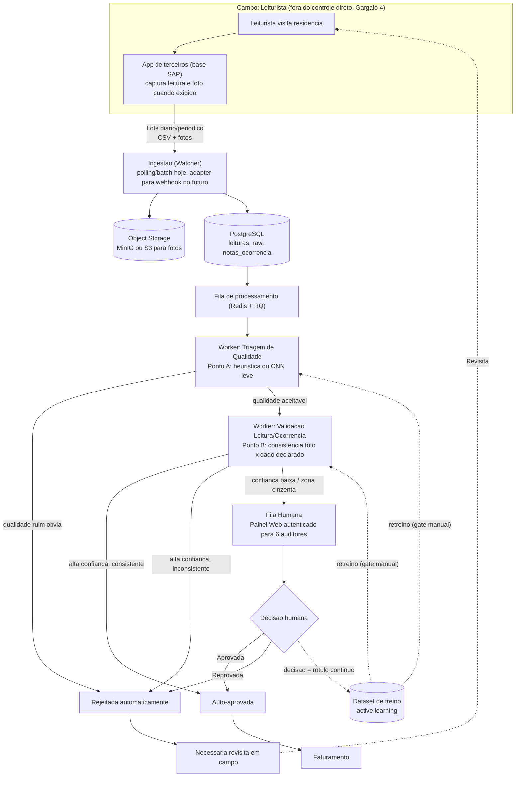
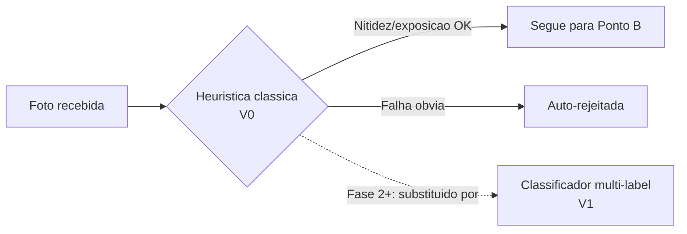
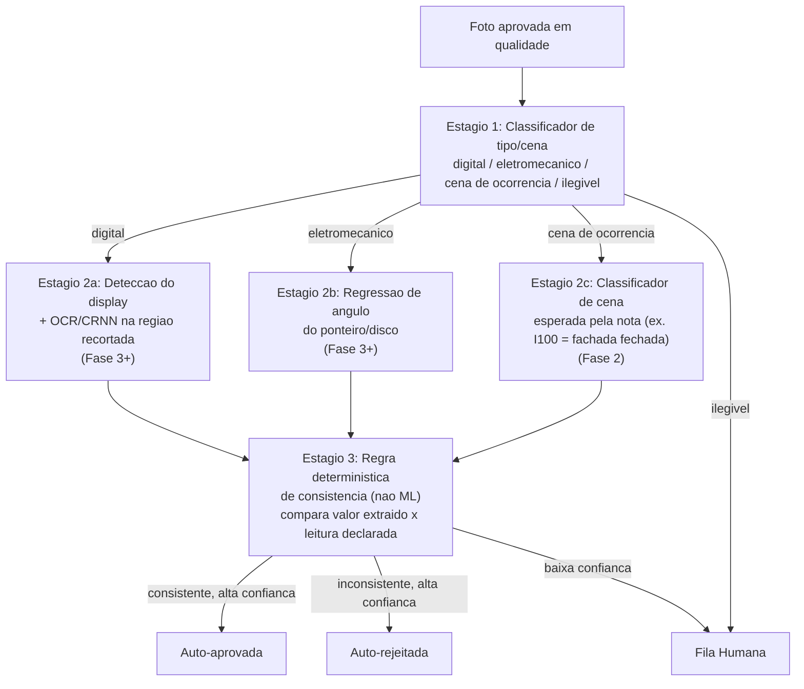
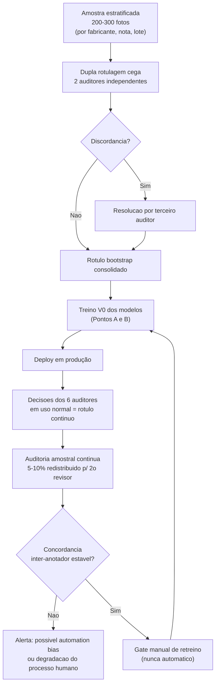
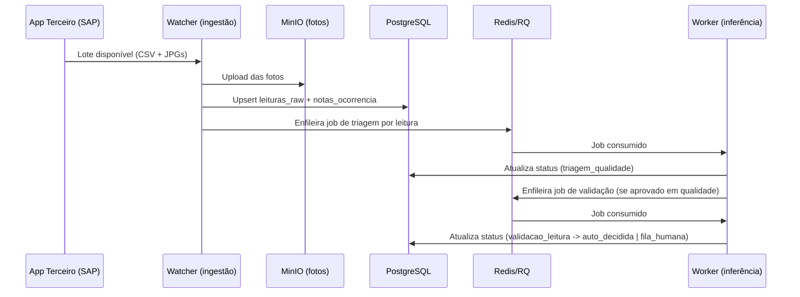
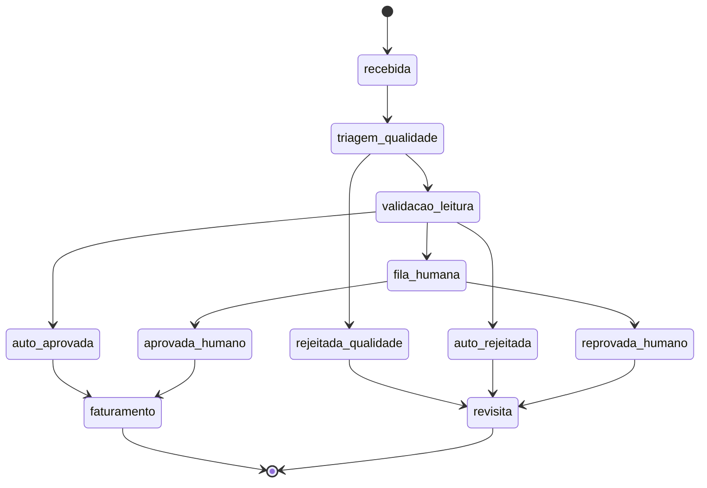
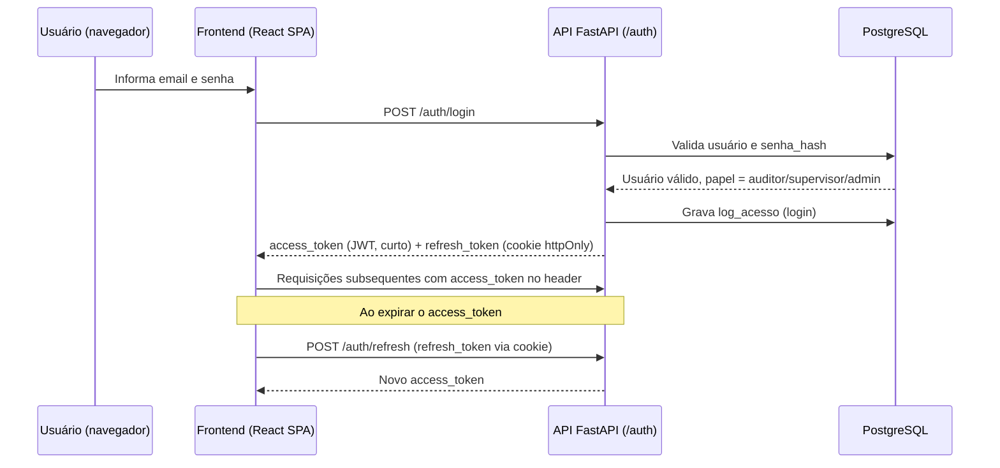

# Arquitetura da Solução (TO-BE): Verificação Automatizada de Fotos de Leitura

> Documento de uso interno do time. Detalha a arquitetura de ponta a ponta prevista em [[01_Entendimento_do_Problema]] (seção 7, "documento específico de solução TO-BE") e incorpora os achados de [[02_Entendimento_dos_Dados]]. Antes de fechar as decisões, o time simulou um debate técnico entre quatro perspectivas especialistas (ML/Visão Computacional, Backend/Plataforma, Produto/MVP, Qualidade de Dados/LGPD) para evitar pontos cegos e over-engineering. A seção 2 registra esse debate e as decisões resultantes; as seções seguintes detalham a arquitetura final.

---

## 1. Objetivo e Princípios de Design

**Objetivo**: reduzir a defasagem (D+1) e a dependência de escala humana (6 pessoas para 30-50 mil fotos/dia) na auditoria de fotos de leitura, automatizando o que é seguro automatizar e mantendo humano no que é incerto. Sem prometer resolver, na v1, o que depende de terceiros fora do controle da Neoenergia.

**Princípios**:

1. **Simplicidade antes de sofisticação**: heurística/modelo pré-treinado antes de treino customizado; monólito antes de microserviços; fila leve antes de orquestrador pesado.
2. **Consistência antes de OCR pleno**: não "ler" o medidor do zero; verificar se a foto é coerente com o que já foi declarado (leitura/ocorrência).
3. **Faseamento com gate de métrica**: cada fase só avança se a fase anterior atingiu o critério de sucesso definido (seção 9), não por calendário.
4. **Humano como fonte de rótulo, não só como usuário final**: a decisão dos 6 auditores é o combustível do aprendizado contínuo (active learning), com salvaguardas contra viés (seção 8.2).
5. **Não prometer o que depende de terceiro**: intervenção em tempo real na captura em campo (Gargalo 4 do doc 01) é tratada como Fase 3, condicionada a negociação comercial/API, nunca como entrega do MVP.

---

## 2. Debate entre Personas e Decisões

Para pressionar as decisões de arquitetura antes de comprometê-las, quatro perspectivas foram deliberadamente colocadas em tensão:

- **Dra. Camila Souza**: Engenheira de Visão Computacional/ML
- **Eng. Rafael Tanaka**: Arquiteto de Backend/Plataforma (Python)
- **Beatriz Lins**: Product Owner pragmática (anti-over-engineering)
- **Dr. Marcos Vieira**: Qualidade de Dados / MLOps / LGPD

| Tema | ML (Camila) | Backend (Rafael) | Produto (Beatriz) | Dados/LGPD (Marcos) | Decisão adotada |
| --- | --- | --- | --- | --- | --- |
| **Onde a IA entra primeiro** | Ponto B é obrigatório desde já: resolve o Gargalo 1/2 (escala e D+1), não só o Gargalo 3 (qualidade) | Desenha para servir ambos os pontos | Só Ponto B no MVP; Ponto A é ficção sem parceria com terceiro | Concorda: Ponto A real-time é "ficção" enquanto a API do terceiro não for validada | **Ponto B (validação pós-ingestão) é o MVP. Ponto A real-time fica na Fase 3, condicionado a negociação/API com o terceiro.** |
| **Triagem de qualidade (V0)** | CNN leve (EfficientNet-B0/MobileNetV3) é o alvo, mas heurísticas clássicas (Laplaciano p/ blur, histograma p/ glare) servem de V0/fallback sem treino | N/D | Comece com heurísticas/modelo pré-treinado; treinar do zero sem rótulo é "construir a casa pelo telhado" | Reforça: sem rótulo hoje, todo treino sério depende de um bootstrap prévio (seção 8.2) | **V0 = heurísticas de visão clássica + gerador de rótulo fraco via degradação sintética. CNN customizada entra na Fase 2, treinada com rótulos de produção reais.** |
| **Validação da leitura (Ponto B)** | Não fazer OCR pleno independente: verificar *consistência* entre a leitura declarada e a região do display recortada. Arquitetura em 3 estágios: classificador de tipo/cena → roteamento condicional (dígito / ponteiro / cena de ocorrência) → regra determinística de consistência | Serving assíncrono via workers, independente de quantos modelos existam | Isso é Fase 2 no mínimo, não é MVP | Alerta para desbalanceamento de classes raras (ex.: fotos de ocorrência real vs. leitura normal) | **Arquitetura de consistência (não OCR pleno) mantida como visão técnica de referência. Implementação faseada: só o classificador de coerência foto×ocorrência entra na Fase 2; leitura de dígito/ponteiro só na Fase 3+, após teste de viabilidade de resolução (seção 5.2.1).** |
| **Infraestrutura de serving** | Preferiria um único modelo multi-task por custo de GPU | FastAPI + Redis/RQ + Postgres + MinIO, workers assíncronos, sem Kubernetes | RQ "nem seria necessário", uma coluna de status resolveria; contra microserviços/K8s | N/D | **RQ + Redis leve adotado. Protege a API de travar em picos de lote sem virar overengineering. Nenhum Kubernetes/microserviço: um `docker-compose` único (api, worker, redis, postgres, minio).** |
| **Tempo real na captura (Ponto A verdadeiro)** | Inviável sem parceria com o terceiro; near-real-time na ingestão é o substituto pragmático | Ingestão desenhada como batch/polling hoje, com adapter plugável (`IngestSource`) para webhook futuro | Fora do MVP: depende de negociação de meses, não de engenharia | Concorda: seria "ficção" arquitetural sem validar a API do terceiro primeiro | **Confirmado fora do MVP. Substituto: triagem em minutos após a ingestão do lote (não mais D+1). API real com o terceiro é Fase 3.** |
| **Rótulos / ground truth** | Active learning: decisão dos 6 auditores como rótulo contínuo | N/D | O próprio uso do assistente gera o rótulo | Alerta para viés/automation bias; propõe bootstrap com **dupla rotulagem cega** (200-300 fotos) + auditoria amostral contínua (5-10%) | **Desenho de Marcos adotado integralmente: bootstrap com dupla rotulagem cega antes de qualquer treino; depois, decisão do auditor como rótulo de produção, com auditoria amostral contínua para medir concordância inter-anotador.** |
| **Split treino/validação** | N/D | N/D | N/D | Split por lote/tempo, nunca aleatório: evita vazamento entre o mesmo medidor/leitura em treino e teste | **Adotado integralmente.** |
| **Métrica de sucesso** | N/D | N/D | % de fotos auto-decididas, taxa de falso-negativo em auto-aprovação, redução de defasagem e de retrabalho | Cobra que "volume processado" não seja métrica principal: mascara degradação silenciosa do modelo | **Métricas de Beatriz como primárias de negócio + monitoramento de drift de Marcos como gate operacional contínuo (seção 8.3), não apenas contagem de volume.** |
| **Frontend** | N/D | API é suficiente, front é decisão de produto | Simplicidade acima de tudo | N/D | **Streamlit foi a escolha inicial de MVP. Decisão revisada para uma stack dedicada de frontend (React), diante da necessidade real de autenticação robusta e controle de acesso por perfil, movimento já previsto na seção 7 original como caminho de evolução. Detalhamento completo na seção 7.** |

---

## 3. Visão Macro da Arquitetura (TO-BE)

**Leitura do fluxo**: o que muda estruturalmente do AS-IS (doc 01, seção 3.2) é que a foto passa por dois filtros automáticos (qualidade e consistência) **antes** de chegar aos 6 auditores. Só a zona de incerteza real chega a humano, e a decisão humana retroalimenta o próprio modelo.

---

## 4. Roadmap por Fases

| Fase | Escopo | Depende de | Critério de saída (gate) |
| --- | --- | --- | --- |
| **Fase 0: Fundação** | Pipeline de ingestão + banco + storage + dashboard de fila humana, **sem modelo nenhum** (100% roteado para humano). Já corta o "download manual" do AS-IS. | N/D | Pipeline estável processando os lotes reais por 1-2 semanas sem modelo |
| **Fase 1: Triagem de qualidade** | Heurísticas de visão clássica + modelo pré-treinado/zero-shot para auto-rejeitar qualidade obviamente ruim (glare extremo, borrão severo, display ausente) | Fase 0 | Falso-negativo de auto-rejeição (rejeitar foto na verdade boa) próximo de zero, validado por amostragem humana |
| **Fase 2: Auto-aprovação + coerência de ocorrência** | Classificador de coerência foto×nota de ocorrência (ex.: I100 = fachada fechada) treinado com rótulos de produção (bootstrap + active learning); auto-aprovação de casos de alta confiança | Fase 1 gerou volume suficiente de decisões humanas rotuladas | Taxa de falso-negativo em auto-aprovação (aprovar foto na verdade inválida) dentro do limite tolerável definido com o cliente (seção 9) |
| **Fase 3: Leitura de dígito/ponteiro + Ponto A real** | Teste de viabilidade de OCR/regressão de ponteiro na resolução real (360×480px); se viável, valida leitura declarada contra dígito extraído. Em paralelo, negociação comercial/técnica com o terceiro para intervenção em tempo real na captura | Fase 2 estável em produção | Teste de viabilidade de OCR conclusivo (aceito ou descartado com decisão de solicitar maior resolução); acesso a API/webhook do terceiro confirmado ou formalmente descartado |
| **Fase 4: Maturidade do loop contínuo** | Monitoramento de drift maduro, retreino semi-automatizado com gate humano, expansão de cobertura por fabricante de medidor | Fase 2/3 em produção estável | Concordância inter-anotador estável, sem degradação de métricas por 2 ciclos de monitoramento |

---

## 5. Arquitetura de IA

### 5.1 Ponto A: Triagem de Qualidade

- **V0 (Fase 1)**: regras de visão computacional clássica, sem necessidade de treino:
  - Nitidez: variância do Laplaciano (abaixo de um limiar → "fora de foco").
  - Exposição/glare: análise de histograma (picos de saturação → "reflexo").
  - Ausência de display: detector genérico pré-treinado (ex.: modelo de detecção de objeto zero-shot) para checar se há uma região retangular de display no quadro.
- **V1 (Fase 2+)**: classificador multi-label (CNN leve, ex. MobileNetV3, transfer learning) para as classes já mapeadas em [[02_Entendimento_dos_Dados]] (glare, fora de foco, tampa suja/embaçada, enquadramento incorreto, display apagado), treinado com:
  - Dataset sintético (degradação artificial das ~9k fotos reais: blur gaussiano, overlay de glare, downscale); não depende de rótulo manual.
  - Rótulos de produção (decisões humanas da Fase 1) via active learning (seção 8.2).

### 5.2 Ponto B: Validação de Leitura e Coerência de Ocorrência

Arquitetura em 3 estágios, faseada (não é tudo Fase 2):

#### 5.2.1 Gate de viabilidade: resolução da imagem

Antes de comprometer investimento em OCR de dígito/regressão de ponteiro (Fase 3), executar teste rápido (1 dia): rodar um OCR pronto sobre 100-200 fotos reais e medir a taxa de leitura correta contra conferência manual. Se a taxa for insuficiente, a saída é solicitar maior resolução ao cliente. **Não** sofisticar o modelo para compensar uma limitação de captura.

### 5.3 Estratégia de Treino sem Ground Truth (Active Learning)

---

## 6. Arquitetura de Backend e Dados

### 6.1 Stack (Python)

| Componente | Escolha | Por quê |
| --- | --- | --- |
| API | **FastAPI** | Fina, só orquestra; tipagem via Pydantic; expõe também as rotas de autenticação (seção 7) |
| Fila | **Redis + RQ** | Mais simples de operar que Celery+broker dedicado; suficiente para o volume diário |
| Banco | **PostgreSQL** | Único banco; volume (~9-15k registros/dia) é trivial |
| Armazenamento de fotos | **MinIO** (ou S3 se já houver contrato cloud) | Não guardar imagem em disco de VM nem no Postgres |
| Inferência dos modelos | Workers RQ dedicados (CPU/ONNX otimizado ou GPU conforme necessidade) | Desacopla disponibilidade da API da disponibilidade do modelo |
| Orquestração de infra | **docker-compose** (api, worker, redis, postgres, minio, frontend) | Kubernetes só entra se/quando volume ou equipe crescerem; hoje seria custo puro |

> O frontend deixou de ser Python (Streamlit) e passou a ser uma stack dedicada, descrita na seção 7, para suportar autenticação robusta e controle de acesso por perfil.

### 6.2 Pipeline de Ingestão

> Ponto de extensão: a ingestão vive por trás de uma interface `IngestSource`. Hoje é `BatchPollingSource` (varredura periódica do diretório/bucket de staging); se o terceiro abrir API/webhook confirmado (pendência aberta no doc 01, seção 8), troca-se para `WebhookSource` sem alterar o resto do pipeline.

### 6.3 Máquina de Estados

Toda transição grava uma linha em `historico_status` (append-only); nunca um `UPDATE` destrutivo do status atual sem histórico, para permitir medir a taxa de "fotos inutilizáveis" (lacuna identificada no doc 02, seção 5.2) e auditar decisões.

### 6.4 Modelo de Dados (essencial)

- **`leituras`**: `id`, `numero_medidor` (array, por conta dos ~9% de casos com múltiplos números), `posicao_lida`, `nota_ocorrencia_codigo` (nullable), `foto_path`, `status_atual`, `lote_origem`, `criado_em`.
- **`notas_ocorrencia`**: `codigo`, `descricao`, `exige_foto`, `padrao_esperado` (ex.: "fachada/portão fechado" para I100).
- **`historico_status`**: `leitura_id`, `status`, `ator` (worker/modelo/auditor), `confianca` (nullable), `timestamp`.
- **`revisoes_humanas`**: `leitura_id`, `auditor_id`, `decisao`, `motivo`, `timestamp`, `redistribuida_para_auditoria` (bool, para o loop de auditoria amostral da seção 8.2).
- **`quarentena`**: `leitura_id`, `tipo_inconsistencia` (`nota_exige_sem_foto`, `foto_sem_exigencia`, `codigo_nao_mapeado`, `medidor_multiplo`), `severidade`, `resolvido` (bool).
- **`usuarios`**: `id`, `nome`, `email`, `senha_hash`, `papel` (`auditor`, `supervisor`, `admin`), `ativo` (bool), `criado_em`. Ver seção 7 para o desenho completo de autenticação.
- **`refresh_tokens`**: `id`, `usuario_id`, `token_hash`, `expira_em`, `revogado` (bool), `criado_em`.
- **`log_acesso`**: `usuario_id`, `evento` (`login`, `logout`, `login_falho`), `ip_origem`, `timestamp`. Append-only, mesmo padrão do `historico_status`.

### 6.5 Endpoints Essenciais

| Método/Rota | Função |
| --- | --- |
| `POST /auth/login` | Autentica usuário e emite access token + refresh token (seção 7) |
| `POST /auth/refresh` | Renova o access token a partir de um refresh token válido |
| `POST /auth/logout` | Revoga o refresh token corrente |
| `GET /auth/me` | Retorna usuário autenticado e seu papel (para o frontend ajustar a interface) |
| `POST /ingest/batch` | Dispara processamento de um lote já em staging |
| `POST /ingest/webhook` | Endpoint pronto, desativado até negociação com o terceiro (Fase 3) |
| `GET /leituras/{id}` | Detalhe de uma leitura + histórico |
| `GET /fila-humana` | Lista paginada/filtrável (por motivo, nota, lote) para o dashboard. Requer papel `auditor` ou superior |
| `POST /fila-humana/{id}/decisao` | Registra decisão do auditor (aprova/reprova + motivo). Requer papel `auditor` ou superior |
| `GET /quarentena` | Lista inconsistências de dados pendentes (seção 8.1). Requer papel `supervisor` ou `admin` |
| `GET /metricas/qualidade` | Taxa de auto-decisão, falso-negativo estimado, drift (seção 8.3); preenche a lacuna de baseline citada no doc 02. Requer papel `supervisor` ou `admin` |

---

## 7. Frontend / Dashboard de Auditoria

### 7.1 Decisão e Motivação

**Decisão**: SPA dedicada em **React + TypeScript + Vite**, consumindo a API FastAPI via REST.

**Por quê a mudança em relação ao Streamlit**: Streamlit é rápido de construir, mas trata autenticação, sessão e controle de acesso por perfil como extensão de terceiros, não como parte nativa do framework. Como o requisito atual é ter login robusto e múltiplos perfis de acesso (auditor, supervisor, admin), com espaço para evoluir para SSO corporativo, uma SPA dedicada com um backend de autenticação próprio (seção 7.2) dá controle total sobre esse fluxo sem depender de gambiarra em cima de uma ferramenta pensada para prototipagem de dados.

**Componentes da stack**:

| Camada | Escolha | Por quê |
| --- | --- | --- |
| Framework | **React + TypeScript** | Ecossistema maduro, tipagem estática reduz erro de integração com a API |
| Build/dev server | **Vite** | Start rápido, HMR eficiente, build simples de servir via nginx no `docker-compose` |
| Componentes de UI | **Mantine** (ou shadcn/ui + Tailwind) | Componentes de formulário, tabela e autenticação já prontos; evita reinventar tela de login, tabela paginada e formulários de aprovação/reprovação |
| Estado remoto/cache | **TanStack Query** | Sincroniza automaticamente com a API (fila humana, métricas), tratando revalidação e cache sem estado global manual |
| Roteamento | **React Router** | Rotas protegidas por papel (seção 7.2), padrão de mercado |

### 7.2 Autenticação e Controle de Acesso

- **Fluxo de login**: `POST /auth/login` (email + senha) retorna um **access token JWT de curta duração** (ex.: 15 minutos) e um **refresh token** (ex.: 7 dias), este último armazenado como cookie `httpOnly` e `secure` (nunca em `localStorage`, para reduzir exposição a XSS).
- **Renovação**: o frontend chama `POST /auth/refresh` automaticamente quando o access token expira, sem exigir novo login enquanto o refresh token for válido e não revogado (tabela `refresh_tokens`, seção 6.4).
- **Senhas**: hash com `bcrypt` ou `argon2`, nunca texto plano; nunca log de senha, nem em `log_acesso`.
- **Papéis (RBAC)**: `auditor` (acessa e decide a fila humana), `supervisor` (acessa métricas e quarentena, além do que o auditor acessa), `admin` (gerencia usuários e papéis). Cada rota da API valida o papel via dependency do FastAPI, não só o frontend esconder o botão.
- **Log de acesso**: toda tentativa de login (sucesso ou falha) grava em `log_acesso` (seção 6.4), permitindo detectar tentativas de força bruta e compor trilha de auditoria de quem aprovou/reprovou o quê.
- **Rate limiting no login**: bloqueio temporário após N tentativas falhas consecutivas por usuário/IP, para mitigar força bruta.
- **Caminho de evolução para SSO corporativo**: o endpoint `POST /auth/login` fica atrás de uma interface `AuthProvider` (mesmo padrão do `IngestSource` da seção 6.2). Hoje é `LocalPasswordAuthProvider`; se a Neoenergia/Iberdrola quiser integrar com o provedor de identidade corporativo, troca-se para `OIDCAuthProvider` (ex.: Azure AD / Entra ID, ou outro IdP compatível com OpenID Connect) sem reescrever o resto do backend nem do frontend.

### 7.3 Telas Essenciais do MVP

- Tela de login.
- Fila de revisão priorizada (papel `auditor` ou superior), com foto ao lado da leitura/nota declarada e botões de aprovar/reprovar com campo de motivo, consumindo `GET /fila-humana` e `POST /fila-humana/{id}/decisao`.
- Painel de métricas e quarentena (papel `supervisor` ou `admin`), consumindo `GET /metricas/qualidade` e `GET /quarentena`.
- Tela de gestão de usuários e papéis (papel `admin`).

### 7.4 Implantação

O build de produção do React (arquivos estáticos) é servido por um container `nginx` dedicado, incluído no mesmo `docker-compose` do backend (seção 6.1). O nginx também atua como proxy reverso para a API, simplificando a configuração de CORS e permitindo servir frontend e backend sob o mesmo domínio.

---

## 8. Qualidade de Dados, Privacidade e MLOps

### 8.1 Validação na Ingestão: Quarentena, não Bloqueio Total

Todo lote passa por um validador de esquema+regras antes de qualquer modelo:

- **Mismatch nota×foto** (61 casos "exige e não tem" / 145 casos "não exige mas tem", doc 02 seção 5.1): não bloqueia o lote inteiro (paralisaria faturamento). "Exige foto e não tem" é bloqueante **daquele registro** (não fatura sem evidência); "tem foto mas não exigia" é só log analítico em `quarentena`.
- **Código não mapeado** (ex. `V100`): tratado como classe `UNKNOWN_CODE`, nunca descartado silenciosamente. Dispara alerta para o time de negócio atualizar a planilha de referência de 61 códigos.
- **Número de medidor múltiplo** (`"/"`): normalizado em array desde a ingestão. Tratamento definitivo (condomínio? medição compartilhada?) depende de confirmação do cliente; pendência já registrada no doc 02, seção 7.

### 8.2 Rotulagem e Active Learning: Salvaguardas contra Viés

- Bootstrap com **dupla rotulagem cega** (200-300 fotos, amostra estratificada por fabricante/nota/lote) + resolução de discordância por terceiro revisor, **antes** de qualquer treino. Evita herdar viés humano não medido.
- Em produção, decisão do auditor = rótulo contínuo, mas com **auditoria amostral contínua** (5-10% redistribuído para segundo revisor) monitorando concordância inter-anotador. Queda nessa métrica é sinal de possível *automation bias* (auditor confiando demais no modelo) ou degradação do processo humano.
- **Split treino/validação por lote/tempo**, nunca aleatório: evita vazamento entre fotos do mesmo medidor/leitura.
- Atenção a classes raras: acurácia agregada alta pode mascarar F1 péssimo na classe minoritária que mais importa auditar (ex. fotos de ocorrência real vs. leitura normal, que é 67%/33% mas com sub-distribuição bem mais desbalanceada por código específico; ver doc 02, seção 4.1).

### 8.3 Monitoramento de Drift

Monitorar continuamente: distribuição de classes de defeito de qualidade, taxa de rejeição do modelo vs. baseline histórica, confiança média das predições, aparecimento de fabricante/modelo de medidor não visto em treino. Gatilho de alerta: desvio maior que X pontos percentuais da baseline por 3 dias seguidos. **Retreino nunca é automático.** É decisão humana disparada por esses alertas (gate manual, seção 5.3).

### 8.4 Privacidade e Retenção (LGPD)

A ausência de dados sensíveis na amostra analisada (doc 02, seção 5.4) não é garantia na escala real (30-50 mil fotos/dia). Medidas:

- Filtro automático de detecção de rosto/documento como triagem antes de qualquer foto chegar a um humano ou a um dataset de treino.
- Política de retenção com prazo definido (ex.: fotos aprovadas sem ocorrência retidas por período menor; fotos em disputa/auditoria retidas até resolução). Sem retenção indefinida.
- Disclaimer de tratamento de dados mantido no processo, como já recomendado no doc 02.

---

## 9. Métricas de Sucesso

| Métrica | Definição | Meta inicial (Fase 1-2) |
| --- | --- | --- |
| % de fotos auto-decididas | Fração do volume diário que não chega à fila humana | 30-40% já é vitória: não precisa resolver 100% no MVP |
| Falso-negativo em auto-aprovação | Foto aprovada automaticamente que era, na verdade, inválida | Próximo de zero: é o número que trava ou libera expansão do auto-aprova (risco reputacional/fatura) |
| Falso-positivo em auto-rejeição | Foto rejeitada automaticamente que era, na verdade, válida | Baixo, monitorado por amostragem humana |
| Redução de defasagem | Tempo entre chegada da foto e decisão final | De D+1 para minutos/horas após ingestão |
| Redução de retrabalho | Nº de revisitas de campo por reprovação evitáveis | Medido em ciclos, impacto de negócio real |
| Concordância inter-anotador | Estabilidade do rótulo humano ao longo do tempo | Estável ou crescente: queda é sinal de alerta (seção 8.2) |

---

## 10. Riscos e Mitigações

| Risco | Origem (persona) | Mitigação |
| --- | --- | --- |
| Prometer triagem em tempo real na captura sem controle sobre o app de terceiros | ML, Produto, Dados/LGPD (consenso) | Fora do MVP; Fase 3 condicionada a negociação/API confirmada |
| Treinar modelo do zero sem rótulo, gastando tempo sem entregar valor | Produto | V0 = heurísticas + pré-treinado; treino customizado só após bootstrap rotulado |
| Modelo herdar viés/erro sistemático dos próprios auditores | Dados/LGPD | Bootstrap com dupla rotulagem cega + auditoria amostral contínua |
| Dataset desbalanceado por fabricante de medidor ou por classe de ocorrência rara | ML, Dados/LGPD | Amostragem estratificada no bootstrap; monitorar F1 por classe, não só acurácia agregada |
| Pico de lote travando a API esperando GPU/CPU liberar | Backend | Processamento assíncrono via fila (Redis/RQ), API nunca bloqueia esperando inferência |
| Overengineering de infraestrutura (Kubernetes, microserviços) para volume/equipe atuais | Produto | docker-compose único; Kubernetes só se volume/equipe crescerem de fato |
| Degradação silenciosa do modelo em produção sem detecção | Dados/LGPD | Monitoramento de drift com gate manual de retreino (seção 8.3) |
| Vazamento de dados pessoais em fotos de campo na escala real | Dados/LGPD | Filtro de detecção de rosto/documento + política de retenção definida |
| Código de ocorrência novo (como `V100`) não mapeado quebrando o pipeline | Dados/LGPD | Classe `UNKNOWN_CODE` explícita + alerta, nunca descarte silencioso |
| Acesso indevido à fila humana, à quarentena ou às métricas por usuário sem permissão | Backend/Segurança | RBAC validado na API (não só no frontend), tokens de curta duração, refresh token em cookie `httpOnly`/`secure`, log de acesso e rate limiting no login (seção 7.2) |

---

## 11. Perguntas em Aberto (herdadas dos docs 01/02) e Tratamento no Plano

| Pergunta em aberto | Como este plano trata |
| --- | --- |
| O app/plataforma de terceiros oferece API/webhook para validação em tempo real? | Tratado como pré-requisito da Fase 3 (Ponto A real); ingestão desenhada com adapter `IngestSource` para não bloquear o MVP enquanto isso não é confirmado |
| Quais são as principais notas de ocorrência além de I100 e seus padrões esperados de foto? | Alimenta o classificador de coerência de cena da Fase 2 (seção 5.2, Estágio 2c); precisa ser levantado junto ao cliente antes dessa fase |
| Existe SLA formal entre captura e aprovação/reprovação? | Vira input direto para a meta de "redução de defasagem" (seção 9) |
| O contrato com o terceiro permite integração ou é caixa-preta? | Mesmo tratamento da primeira pergunta: gate de decisão da Fase 3 |
| Causa dos 61 casos "exige foto sem foto" e 145 "não exige mas tem foto"? | Tratado operacionalmente via fila de `quarentena` (seção 8.1) enquanto a causa raiz não é confirmada com o cliente |
| Significado do código `V100` não mapeado? | Tratado como `UNKNOWN_CODE` com alerta (seção 8.1), não bloqueia pipeline |
| O prefixo `DDMMAA_HHMM` no nome do arquivo é lote de extração ou data/hora real? | Não é bloqueante para a arquitetura proposta (usado só como `lote_origem`), mas deve ser confirmado para a métrica de defasagem (seção 9) ser precisa |
| Significado de múltiplos números de medidor separados por "/"? | Normalizado em array na ingestão (seção 8.1); tratamento definitivo pendente de confirmação do cliente |
| É possível solicitar fotos em maior resolução? | Vira decisão condicionada ao gate de viabilidade de OCR da Fase 3 (seção 5.2.1) |

---

## 12. Próximos Passos Imediatos

1. Validar com o cliente, antes do Kickoff (12/09): existência de API/webhook do terceiro, SLA de auditoria, causa dos mismatches nota×foto, significado de `V100` e dos números de medidor múltiplos.
2. Levantar as descrições/padrões esperados de foto para todos os 61 códigos (não só I100), a partir da planilha `DESCRIÇÃO NOTAS LEITURISTAS X SOLICITAÇÃO DE FOTO.xlsx`.
3. Montar a Fase 0 (ingestão + banco + dashboard, sem modelo) usando as 4 pastas reais de `Base cliente/` como dados de desenvolvimento/teste.
4. Executar o teste de viabilidade de OCR (seção 5.2.1) em paralelo, com baixo custo, para não bloquear a decisão de arquitetura da Fase 3 até mais tarde no projeto.
5. Definir com o cliente a amostra estratificada de bootstrap (200-300 fotos) para a dupla rotulagem cega (seção 8.2).

---

## Referências

- [[01_Entendimento_do_Problema]]
- [[02_Entendimento_dos_Dados]]
- Debate técnico entre personas (Dra. Camila Souza, Eng. Rafael Tanaka, Beatriz Lins, Dr. Marcos Vieira): síntese na seção 2
- Base fornecida pelo cliente (`Base cliente/`, 4 pastas + planilha de notas × foto)
- Índice do vault: [[00_Indice]]
