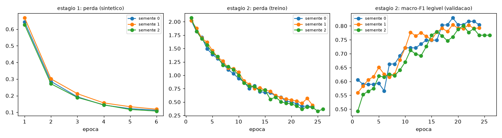
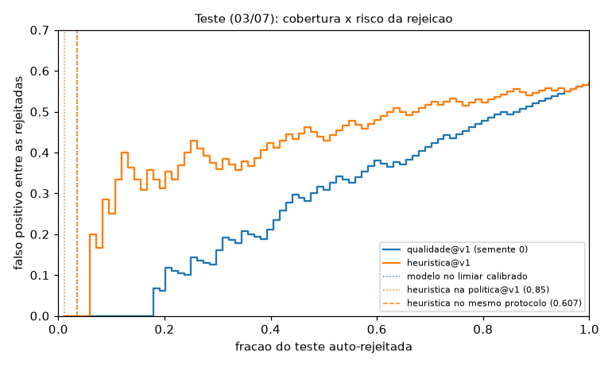

# Modelo de qualidade `qualidade@v1` (marco M7), rodada 20261016-213656

> **Conclusão:** o modelo **separa legível de ilegível melhor que a heurística**. No mesmo teste,
> o AUROC fica +0,20 acima (IC 95% pareado de +0,09 a +0,32). **A segurança da auto-rejeição não
> está demonstrada**: o zero falso positivo se apoia em 3 fotos e não se repete entre sementes.
> O modelo **entra desligado** (`DETECTOR_QUALIDADE=heuristica` continua o padrão). Ligar depende
> da inspeção humana das 355 fotos que só o modelo rejeita.

Data: 2026-10-16/17. MobileNetV3-Small (ImageNet) com cabeças de cena, defeitos e legível
(`ml/src/mlinsp/modelo.py`). O treino em dois estágios é feito por `mlinsp.train_quality`,
seguido de `calibrate`, `evaluate` e `export_onnx`. Para reproduzir: `make m7-treinar` e depois
`make m7-calibrar|m7-avaliar|m7-exportar|m7-paridade RODADA=20261016-213656`. Todos os números saem
dos json desta pasta. "Heurística" aqui é sempre a `heuristica@v1` do M5, que não se confunde com a
`politica@v0` (nunca rejeita).

## Resumo

| Item | Resultado |
| --- | --- |
| Critério de entrada (E1 + E2 + E3) | **Passa em 1 das 3 sementes** (a 0, escolhida pela validação). A semente 1 não acha limiar sem FP na validação; a semente 2 tem 2 FP no teste |
| E1: macro-F1 de legível no teste (03/07, 83 fotos) | modelo **0,766** × heurística 0,651. Média das 3 sementes: 0,785 ± 0,018. ΔmacroF1 da semente 0 com IC 95% pareado de −0,01 a +0,24 |
| AUROC no teste (positivo = ilegível) | 0,872 × 0,670. **ΔAUROC +0,20 (IC 95% de +0,09 a +0,32)** |
| E2: falsos positivos no teste no limiar calibrado | **0** em 3 rejeitadas (IC 95% de Wilson da precisão: 0,44 a 1,00; limite superior do erro: 63%) |
| E3: cobertura de rejeição | base inteira 3,72% (425); **só no lote de teste: 3,69%**. A base inteira inclui as fotos de treino |
| Mesma comparação, mesmo protocolo | heurística com limiar de zero FP na validação (0,607): 3 rejeitadas e 0 FP no teste, **270 na base (2,36%)**. Vantagem real: **~1,6×** (425 × 270), não 4,9× (425 × 87) |
| Limiar (`politica@v2`) | `ilegivel >= 0,976`; `limiar_aprova` = None |
| Reprodutibilidade | semente 0 treinada duas vezes: logits **idênticos** (diferença 0,0) |
| Paridade torch × onnxruntime (100 fotos) | logit de legível 3,9e-5 e cena 3,1e-5; probabilidades < 1e-5 (critério < 1e-4) |
| Paridade de ponta a ponta (backend × torch, 11.419 fotos) | máximo de 6,0e-6 em `ilegivel`; **0 decisões diferentes** |
| Tempo de treino | 12,4 min, 3 sementes + 1 repetição (MPS, Apple M5) |
| Latência no worker real | média 5,4 ms, p95 6 ms por foto (decodificação + inferência, gravada em `resultados_inferencia`) |
| `.onnx` no git | **Não** (seção 6). sha256 `ab653b59e90e…` em `qualidade.json`, exportado do commit `5c774da` com a árvore de código limpa |

## 1. Desvios do plano (registrados como tais)

| Plano (doc 04 e T-M7-xx) | Feito | Por quê |
| --- | --- | --- |
| Entrada nativa 360×480 (4.1) | **224 letterbox** | Lab 2, K1: nenhuma métrica de qualidade melhorou mais de 0,02 na nativa, e 224 custa 1/3 da latência |
| Early stopping com paciência 3, 10 épocas (4.2) | **paciência 5, mínimo de 10, teto de 30 épocas** | Com paciência 3, duas sementes pararam na 1ª e na 5ª época (rodada `20261016-212320`, descartada). A macro-F1 de 82 fotos oscila ±0,03 entre épocas |
| Estágio 1 com 20 épocas | **6 épocas** | A perda sintética estabiliza antes (curva da seção 3) |
| T-M7-07: dois limiares por predição seletiva | **só `limiar_rejeita`** | `limiar_aprova` exige ~600 auto-aprovadas rotuladas (doc 04, 5.1); com 329 rótulos, continua None |
| Macro-F1 do aceite sem classe definida | **macro-F1 binária de legível** | É a única decisão que o modelo toma; cena e defeitos são reportados à parte |
| Defeitos treinados com rótulo real (4.2, estágio 2) | **só degradação sintética** | O rótulo humano de defeito tem kappa de 0,15 a 0,41; a regra do plano é não treinar decisão sobre rótulo ambíguo |

## 2. Dados e rótulos

- Partição por lote (`particao.py`): treino 20 e 21/05, validação 22/05, teste 03/07. Nenhuma foto
  ou medidor em comum entre conjuntos.
- Rótulos humanos do Lab 2, por maioria, com a regra do app (`rotulador/consolidar.py`):
  - treino: 163 (90 legíveis, 68 ilegíveis, 5 empates);
  - validação: 82 (43 e 39);
  - teste: 84 (46, 37 e 1 empate).
- Só cena (kappa 0,74) e legível (kappa 0,82) entram na perda.
- Falso positivo = foto auto-rejeitada que **algum** rotulador leu (critério do M5).

## 3. Treino

- **Estágio 1:** 2.500 fotos do treino com `p_ruim` da heurística ≤ 0,05. Cada uma vira uma versão
  limpa e uma degradada (1 ou 2 defeitos, `degradacao.py`), num total de 5.000 exemplos e ~750
  positivos por defeito. O único alvo é a cabeça de defeitos. AdamW, lr 3e-4 com cosseno, flip e
  jitter de ±10%.
- **Estágio 2:** os 163 rótulos humanos (cena e legível). Extrator com lr 5e-5 e cabeças com lr 1e-3.
  Lotes sintéticos intercalados com peso 0,5. A parada usa a macro-F1 de legível na validação.

| Semente | Época escolhida | Macro-F1 validação | Tempo |
| --- | --- | --- | --- |
| 0 | 19 de 24 | 0,829 | 157 s |
| 1 | 19 de 24 | 0,804 | 193 s |
| 2 | 21 de 26 | 0,801 | 213 s |
| 0 (repetição) | 19 de 24 | 0,829 | 177 s |

## 4. Calibração (validação)

- A temperatura minimiza a NLL na validação, e o score de decisão é `p_ilegivel = 1 - sigmoid(z / T)`.
- O limiar é a maior cobertura de rejeição com zero foto lida na validação, arredondado para cima em
  3 casas. Sem o arredondamento, o limiar seria o `p` exato de uma foto de validação, e o ruído
  numérico entre MPS, CPU e onnxruntime (~1e-5) decidia o lado dela.

| Semente | T | Foto lida mais alta | Limiar | Rejeitadas na validação | ECE antes → depois |
| --- | --- | --- | --- | --- | --- |
| **0 (escolhida)** | 1,023 | 0,9613 | **0,976** | 3 de 82 | 0,036 → 0,035 |
| 1 | 1,226 | 0,9874 | nenhum | 0 | 0,080 → 0,073 |
| 2 | 1,330 | 0,8666 | 0,889 | 8 | 0,110 → 0,145 |

## 5. Avaliação no teste (03/07) contra a heurística

A heurística é a `heuristica@v1`, com o `p_ruim` que o worker gravou. O limiar de macro-F1 dela foi
escolhido na validação (0,070). Conjunto: as 84 rotuladas do teste, das quais 83 têm legível sem
empate.

| Métrica (teste) | qualidade@v1, semente 0 | média ± desvio, 3 sementes | heurística@v1 |
| --- | --- | --- | --- |
| macro-F1 de legível | **0,766** | 0,785 ± 0,018 | 0,651 |
| F1 legível / F1 ilegível | 0,800 / 0,732 | | 0,714 / 0,588 |
| PR-AUC (positivo = ilegível) | 0,867 | 0,858 ± 0,008 | 0,624 |
| AUROC | 0,872 | 0,866 ± 0,013 | 0,670 |
| acurácia (IC 95% de Wilson) | 0,771 (0,670 a 0,848) | | 0,663 (0,556 a 0,755) |
| matriz [real legível: prev. legível, prev. ilegível] | [38, 8] | | [35, 11] |
| matriz [real ilegível: prev. legível, prev. ilegível] | [11, 26] | | [17, 20] |
| macro-F1 de cena (informativo) | 0,386 | 0,355 ± 0,033 | n/d |

**Bootstrap pareado no teste** (5.000 reamostragens das mesmas fotos para os dois; modelo menos
heurística; `bootstrap_pareado` em `avaliacao.json`):

| Semente | ΔmacroF1 (IC 95%) | P(Δ ≤ 0) | ΔAUROC (IC 95%) | ΔPR-AUC (IC 95%) |
| --- | --- | --- | --- | --- |
| 0 | +0,12 (−0,01 a +0,24) | 0,036 | +0,20 (+0,09 a +0,32) | +0,24 (+0,11 a +0,37) |
| 1 | +0,14 (+0,01 a +0,27) | 0,018 | +0,21 (+0,09 a +0,32) | +0,22 (+0,11 a +0,36) |
| 2 | +0,15 (+0,02 a +0,28) | 0,012 | +0,18 (+0,07 a +0,30) | +0,22 (+0,11 a +0,36) |

A separação é melhor em todas as sementes, e o IC do AUROC não toca o zero. Na semente escolhida,
o IC da macro-F1 toca o zero por pouco.

**Rejeição: os protocolos precisam ser os mesmos.**

| | limiar | rejeitadas no teste / FP | base inteira | só o lote de teste |
| --- | --- | --- | --- | --- |
| qualidade@v1, semente 0 (zero FP na validação) | 0,976 | 3 / **0** | **425 (3,72%)** | 3,69% |
| heurística, **mesmo protocolo** (zero FP na validação) | 0,607 | 3 / **0** | 270 (2,36%) | 2,22% |
| heurística na `politica@v1` (escolha visual do M5) | 0,85 | 1 / 0 | 87 (0,76%) | 0,75% |

- No mesmo protocolo, a vantagem do modelo é **~1,6×**, não 4,9×. O gate de dados calculou sem o
  arredondamento (limiar 0,6067) e obteve 271 (2,37%).
- O protocolo de zero FP na validação já falhou uma vez: no M5, a faixa 0,6 a 0,85 da heurística
  também tinha zero FP nos rótulos, e a inspeção visual achou fotos legíveis nela. Por isso a v1
  ficou em 0,85.
- O mesmo pode valer para o modelo: zero FP em 3 rejeições não exclui erro de até 63%.

**Critério por semente** (`criterio_entrada_por_semente`):

| Semente | E1 | E2 | E3 (base) | entra |
| --- | --- | --- | --- | --- |
| **0** | sim | sim (3 rejeitadas, 0 FP) | sim (3,72%) | **sim** |
| 1 | sim | não (sem limiar) | não (0%) | não |
| 2 | sim | não (12 rejeitadas, 2 FP) | sim (11,3%) | não |

**Cena:** F1 de 0,90 em digital (70 fotos), 0,14 em eletromecânico (9), 0,50 em ocorrência (3) e
0,00 em não-medidor (1). Fica só como informação.

**Defeitos** (informativo, fora do `p_ruim`, comparados à maioria humana de kappa baixo):
- reflexo: F1 0,14, AUROC 0,56;
- fora_de_foco: F1 0,63, AUROC 0,75;
- tampa_suja: F1 0,24, AUROC 0,67;
- enquadramento: F1 0,33, AUROC 0,64;
- display_apagado: F1 0,00, AUROC 0,62.

**Base inteira** (11.419 leituras): rejeitadas por lote em 200526 / 210526 / 220526 / 030726 =
117 / 98 / 107 / 103. Cruzamento com a heurística na v1: 70 rejeitadas pelos dois, 355 só pelo
modelo, 17 só pela heurística.

## 6. Exportação, contrato e o `.onnx` fora do git

- `ml/artifacts/qualidade.onnx` (3,7 MB, opset 17, lote dinâmico, entrada `float32[N,3,224,224]`,
  saídas em logit) e `ml/artifacts/qualidade.json` (cópia nesta pasta).
- O json traz:
  - `versao`, `rodada`, `limiar_rejeita`, temperaturas e pré-processamento;
  - `onnx_sha256`;
  - `commit` = `5c774da` com `arvore_suja: false`. A primeira exportação citava `a00f1e1` com o
    código do M7 ainda não commitado; foi refeita depois dos commits, com o mesmo sha256.
- **O contrato é amarrado à política:**
  - o `DetectorOnnx` recusa um json cuja `rodada` ou cujo `limiar_rejeita` diverja da política
    registrada para a `versao`, ou cuja `versao` não tenha política de modelo treinado
    (`validar_contrato_onnx`);
  - o `export_onnx` recusa exportar uma rodada nova com uma `versao` já usada por outra rodada.
    Rodada nova = `--versao qualidade@v2` com a `politica@v3` dela.
- **Decisão: o `.onnx` não vai para o git.** É binário, muda a cada treino, deriva de pesos ImageNet
  de terceiros e foi ajustado com fotos do cliente. O hash
  `ab653b59e90e5e8e16637bc5ead99f1beac988df693291f724459b8e53304b72` versionado aqui é o elo, e o
  backend recusa um `.onnx` que não bate com ele.
- **Paridade na exportação:** logit de legível 3,9e-5, cena 3,1e-5 e defeitos 1,1e-4. O de defeitos
  é ruído de float32 em logits de até |12|, que aparece mesmo contra o torch em float64. Em
  probabilidade, tudo fica abaixo de 1e-5.
- **Pré-processamento do backend:** confere com o do ml até 1e-6 por pixel
  (`tests/test_qualidade_onnx.py`).
- **Ponta a ponta:** máximo de 6,0e-6 em `ilegivel` e 0 decisões diferentes nas 11.419 fotos.

## 7. Decisão de entrada

O critério passa na semente escolhida pela validação, e o código entra: `DetectorOnnx`,
`politica@v2` e a política escolhida pelo detector. A auto-rejeição do modelo **fica desligada**,
porque:

1. o zero FP do teste se apoia em 3 rejeições (limite superior do erro: 63%);
2. o critério passa em 1 das 3 sementes;
3. no mesmo protocolo a vantagem de cobertura é 1,6×, e esse protocolo já deixou passar foto legível
   no M5;
4. as 355 fotos que só o modelo rejeita nunca foram vistas por humano.

Ativar (`DETECTOR_QUALIDADE=onnx`, uma linha) depende da inspeção dessas 355. A decisão é do Davi.

## 8. Reprocessamento dos 4 lotes no banco (2026-10-17)

O banco de dev foi restaurado na revisão `1840bea5fdb9`, com dump antes.
- `DETECTOR_QUALIDADE=onnx`, `make triagem-todos` e 4 workers (`detector=qualidade@v1,
  politica=politica@v2`).
- Depois, `make recalcular-todos POLITICA=politica@v1`, para devolver a operação à heurística.
- Os resultados `qualidade@v1` ficam ao lado dos `heuristica@v1`.

| | qualidade@v1 + politica@v2 | heuristica@v1 + politica@v1 |
| --- | --- | --- |
| tempo (4 workers, 11.419 leituras) | 41,4 s | 41,5 s (M5) |
| latência gravada por foto | média 5,4 ms, p95 6 ms | média 3,6 ms, p95 5 ms |
| rejeitada_qualidade 200526 / 210526 / 220526 / 030726 | 117 / 98 / 107 / 103 | 12 / 22 / 32 / 21 |
| rejeitada_qualidade, total | **425 (3,72%)** | 87 (0,76%) |

- As contagens batem uma a uma com as calculadas offline.
- A volta para a v1 restaurou o estado do M5 sem abrir imagem (87 rejeitadas, 11.332 na fila).
- As 55 decisões humanas não foram tocadas.

## 9. Pendências

- Inspeção humana das 355 rejeitadas só pelo modelo (seção 7).
- Os testes do M3 que falhavam sob carga foram corrigidos no `37273e3` (comparavam o relógio do host
  com o `now()` do banco).
- Um abort `libc++abi: recursive_mutex lock failed` na saída do pytest, com os testes passando,
  apareceu uma vez e não se repetiu. Fica em observação.
