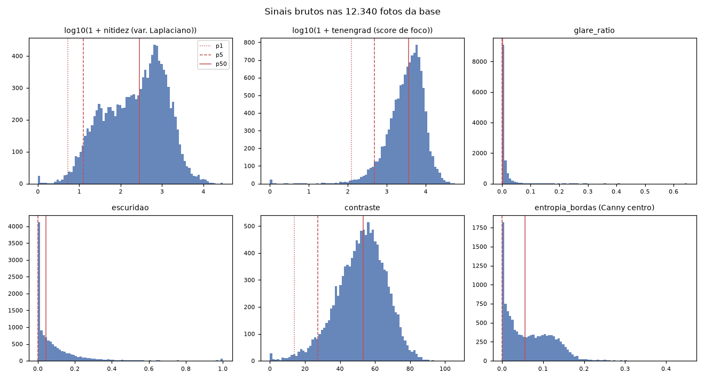
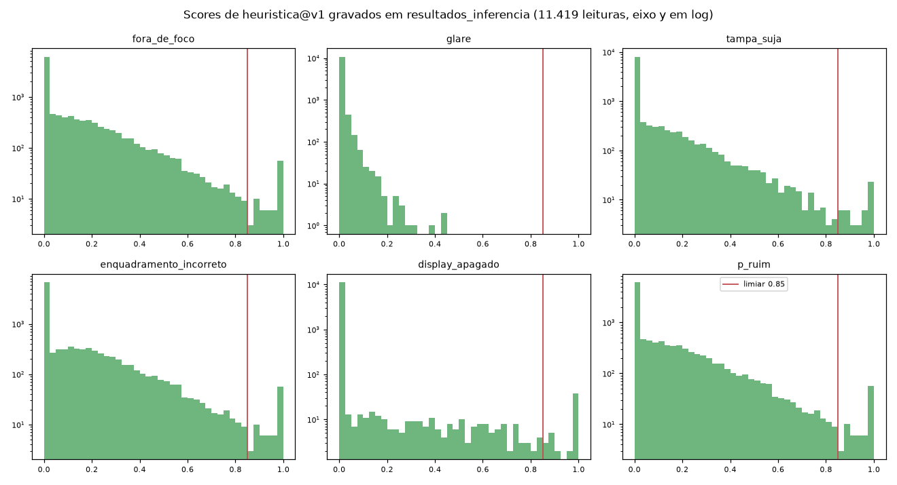
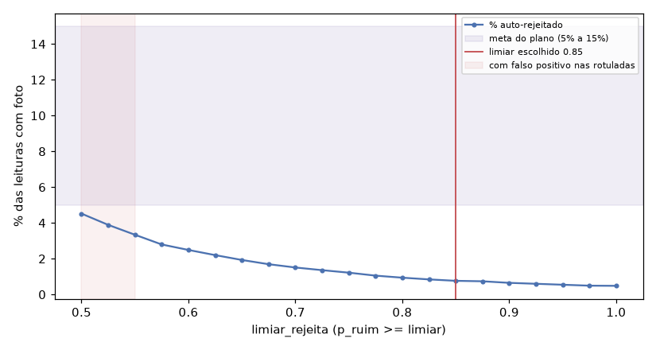

# Heurísticas de qualidade (marco M5)

Data: 2026-10-16. Detector `heuristica@v1` (`app/backend/src/inspecao/inference/heuristics.py`),
política `politica@v1` (`inference/politica.py`). Base: os 4 lotes de `Base cliente/` ingeridos no
banco local. Reprodutível com `make triagem-todos` (worker com `DETECTOR_QUALIDADE=heuristica`) e
`make relatorio-heuristicas LIMIAR=0.85`.

## Resumo

| Item | Resultado |
| --- | --- |
| Limiar escolhido (`limiar_rejeita`) | **0,85** sobre `p_ruim` (maior score entre as 5 classes); `limiar_aprova` continua `None` |
| Auto-rejeitado | **87 de 11.419 leituras com foto (0,76%)** |
| Meta do plano (5% a 15%) | **Não atingida.** O Davi aceitou 0,76% como linha de base que o M7 precisa bater (seção 4) |
| Falso positivo nas fotos rotuladas do Lab 2 | **0** (3 rotuladas auto-rejeitadas, todas ilegíveis para todos os rotuladores) |
| Inspeção humana das 200 fotos dos extremos | **Pendente** (amostra e página prontas, ver "Pendência humana") |
| Triagem das 11.419 leituras, 4 workers no host | **41,5 s** do primeiro claim ao último job (aceite: < 10 min). Latência por imagem: média 3,6 ms, p95 5 ms |
| `recalcular_decisao` nos 4 lotes | 1 a 2 s por passada, sem abrir imagem (teste com storage que falha em qualquer leitura) |
| Paridade backend × `mlinsp` (Lab 2) | 12 features **idênticas, bit a bit**, nas 11.419 fotos com resultado (0 saídas sem `sinais`): `features_v0` recalculado pelo relatório contra os `sinais` que o worker gravou (`paridade_backend_mlinsp` em `heuristicas_resumo.json`, campo `identicas`). As 921 fotos restantes (866 órfãs e 55 já decididas na fila) não passam pela triagem |

## 1. Sinais

As 12 features V0 do Lab 2 foram portadas para o backend com o cálculo idêntico; cinco delas são os
sinais do plano 04, seção 2.

| Sinal do plano | Feature | p1 | p5 | p50 | p99 |
| --- | --- | --- | --- | --- | --- |
| nitidez | `lap_var` | 4,2 | 11,7 | 282,7 | 5.768,6 |
| (foco usado pelo detector) | `tenengrad` | 124,5 | 475,9 | 3.668,1 | 22.353,4 |
| glare_ratio | `frac_estourados` | 0 | 0 | 0,0017 | 0,087 |
| escuridão | `frac_escuros` | 0 | 0 | 0,044 | 0,889 |
| contraste | `contraste` | 13,8 | 27,2 | 53,3 | 81,4 |
| entropia_bordas | `bordas_centro` | 0 | 0 | 0,057 | 0,220 |

`bordas_centro` é exatamente 0 em 5,9% das fotos, e 2 das 15 rotuladas nessa situação foram
lidas por alguém: centro sem borda Canny sozinho não indica enquadramento ruim.

## 2. Scores

Cada sinal vira um score de "ruim" em [0, 1] por uma rampa entre dois pontos fixos (`ESCALAS` em
`heuristics.py`): o valor `ok` (score 0, mediana da base) e o valor `lixo` (score 1). Os scores
usam os nomes das 5 classes do plano 04, seção 1.1, para que a tela da fila e a política leiam o
mesmo formato que o modelo treinado vai produzir no M7.

| Classe | Score |
| --- | --- |
| `fora_de_foco` | rampa log do tenengrad: 3.668 (mediana) → 0; 50 → 1 |
| `display_apagado` | min(rampa de `frac_escuros` 0,5 → 0 e 1,0 → 1, foco) |
| `glare` | min(rampa de `frac_estourados` 0 → 0 e 0,5 → 1, foco) |
| `tampa_suja` | min(rampa de contraste 53 → 0 e 0 → 1, foco) |
| `enquadramento_incorreto` | min(rampa de `bordas_centro` 0,057 → 0 e 0 → 1, foco) |

Duas decisões vieram das fotos rotuladas, não do plano:

1. **Foco pelo tenengrad, não pela variância do Laplaciano.** Na cauda baixa, `lap_var < p2` já
   pega uma foto rotulada legível; `tenengrad < p3` não pega nenhuma.
2. **Toda classe passa pelo foco** (mínimo com o score de foco). Na inspeção visual da cauda,
   quadro escuro com medidor nítido (armário fechado, flash fraco), medidor sobre fundo branco
   estourado e eletromecânico noturno legível apareciam com escuridão ou glare altos. Sem esse
   mínimo, a única foto legível com escuridão alta (`..._20000000011902952878_000`, eletromecânico
   noturno, dois rotuladores leram) cairia acima de qualquer limiar útil.

Consequência: na v1 `p_ruim` é, na prática, o score de foco. Os outros quatro scores informam a
tela (por que a foto é ruim), mas não decidem sozinhos.

## 3. Escolha do limiar

Evidência de falso positivo: as 328 fotos rotuladas no Lab 2 que estão no banco (188 legíveis para
algum rotulador). Foto auto-rejeitada que **qualquer** rotulador marcou legível conta como falso
positivo. Decisões da fila humana também contam como evidência, exceto as de contas de domínio de
exemplo ou teste (`DOMINIOS_DE_TESTE` em `relatorio_heuristicas.py`): as 55 do banco local são de
testes E2E e demo (`auditor.e2e@exemplo.com.br`, `demo@exemplo.com.br`), não de auditoria.

| limiar | auto-rejeitadas | % | rotuladas acima | falsos positivos |
| --- | --- | --- | --- | --- |
| 0,500 | 516 | 4,52 | 16 | 3 |
| 0,550 | 381 | 3,34 | 13 | 1 |
| 0,575 | 319 | 2,79 | 10 | 0 |
| 0,650 | 220 | 1,93 | 6 | 0 |
| 0,750 | 139 | 1,22 | 5 | 0 |
| 0,800 | 107 | 0,94 | 3 | 0 |
| **0,850** | **87** | **0,76** | **3** | **0** |
| 0,900 | 74 | 0,65 | 2 | 0 |

(tabela completa em `heuristicas_resumo.json`)

A foto legível com maior `p_ruim` tem 0,552. Os rótulos sozinhos permitiriam 0,575 (2,8%). O
limiar ficou em 0,85 porque a inspeção visual prévia das faixas abaixo dele, feita pelo agente
nas miniaturas (não substitui a inspeção humana), achou fotos que um auditor provavelmente leria:
roletes de eletromecânico legíveis com a foto toda lavada (0,62 a 0,64), display grande nítido
sob tampa embaçada (0,63), registradores com dígitos visíveis em fotos escuras (0,75 a 0,82).
Acima de 0,85 só apareceram quadros pretos, vermelhos ou cinzas sem medidor e tampas opacas sem
dígito visível. O plano manda apertar até zero falso positivo mesmo sacrificando cobertura; com
3 rotuladas acima do limiar, o rótulo não sustenta mais do que isso.

Contagem por lote com a política v1:

| Lote | Leituras com foto | rejeitada_qualidade | fila_humana | % auto-rejeitado |
| --- | --- | --- | --- | --- |
| 200526_0352 | 2.922 | 12 | 2.910 | 0,41 |
| 210526_0335 | 2.881 | 22 | 2.859 | 0,76 |
| 220526_0408 | 2.821 | 32 | 2.789 | 1,13 |
| 030726_0121 | 2.795 | 21 | 2.774 | 0,75 |
| **Total** | **11.419** | **87** | **11.332** | **0,76** |

Mais as 55 do lote 200526_0352 já decididas na fila (27 aprovadas, 28 reprovadas), que a
re-decisão não reabre, e as 2.195 `sem_foto`.

## 4. Por que a cobertura fica abaixo da meta

Os sinais clássicos separam mal legível de ilegível fora da cauda extrema. Nas rotuladas, o AUROC
de cada uma das 12 features sozinha para "ilegível" fica entre 0,50 e 0,69 (a melhor é
`lap_var_centro`, 0,69), e no Lab 2 nem a regressão logística sobre as 12 features passou de
AUROC 0,816 na validação. Das 140 rotuladas ilegíveis, a v1 rejeita 3. Atingir 5% exigiria limiar abaixo de 0,50, onde já há 3 falsos
positivos entre as 16 rotuladas acima dele.

O que isso diz para o plano: a heurística serve para tirar da fila o lixo óbvio (quadro preto,
foto sem nenhum detalhe), não para reduzir a fila em 5% a 15%. A redução de carga real depende do
modelo do M7.

**Decisão (Davi, 2026-10-16):** a meta de 5% a 15% do M5 é substituída por esta linha de base.
O M7 precisa bater **0,76% de auto-rejeição com zero falso positivo** no mesmo conjunto rotulado
(além do critério de macro-F1 do doc 06). Se o modelo treinado não rejeitar mais do que isso sem
falso positivo, a heurística segue em operação.

## 5. Pendência humana: inspeção das 200 fotos dos extremos

O aceite do M5 exige zero falso positivo confirmado por inspeção humana de 200 fotos. Isso
**não foi feito**. Está pronto:

- `heuristicas_amostra_200.csv`: as 200 leituras com maior `p_ruim`. Grupo `pior` (100: as 87
  auto-rejeitadas e as 13 seguintes) e grupo `limitrofe` (as 100 seguintes, `p_ruim` de 0,67 a
  0,82, ainda na fila). Colunas `legivel_inspecao` e `inspetor` em branco.
- `heuristicas_inspecao.html`: abre direto do disco, no repo, e mostra as fotos a partir de
  `Base cliente/` (nada é copiado para o git). Marcar sim / não / dúvida em cada foto (clique
  amplia) e exportar o CSV.

Como fechar: qualquer `sim` no grupo `pior` com `decisao_v1 = rejeitar` é falso positivo, e o
limiar sobe acima do `p_ruim` dessa foto. Se o grupo `limitrofe` vier todo `nao`, o limiar pode
descer até o menor `p_ruim` sem nenhum `sim`. Nos dois casos o limiar novo entra como uma versão
nova, `politica@v2` em `POLITICAS` (e `POLITICA_ATUAL` apontando para ela), seguida de
`make recalcular-todos POLITICA=politica@v2`, sem reabrir imagem. **Nunca editar `POLITICA_V1` no
lugar**: o histórico de status grava a versão que decidiu cada leitura, e mudar o limiar sob o
mesmo nome tornaria esse registro falso.

Efeito operacional do recálculo: enquanto `recalcular_decisao` roda num lote, as leituras
re-decidíveis desse lote ficam travadas até o commit (1 a 2 s nos lotes reais), e
`/fila-humana/proxima` filtrada por esse lote responde fila vazia nesse intervalo. Itens que um
auditor estava pegando no instante do recálculo são pulados e aparecem em warning no log do
worker; rodar `make recalcular-todos` de novo os alcança. O warning traz só a contagem por lote
(aproximada, porque é contada antes do lock), sem os ids das leituras puladas.
